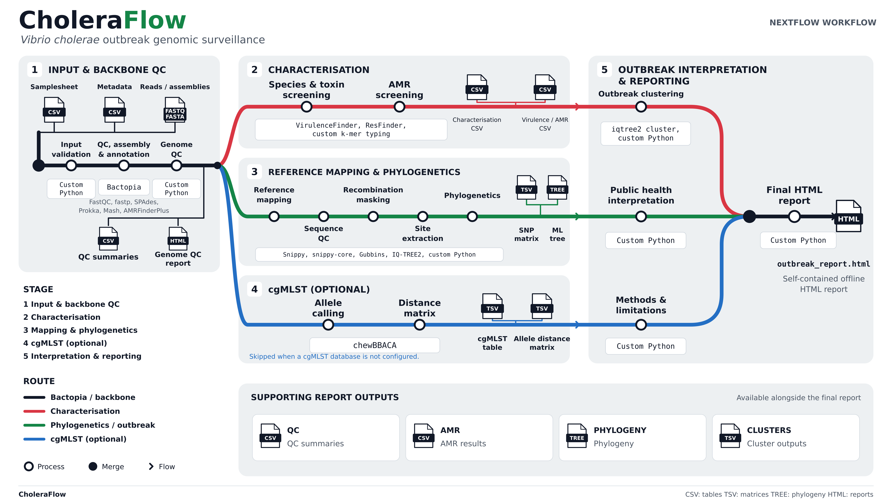

# CholeraFlow

<p align="center">
  
  
  
  
  
</p>

CholeraFlow is a Nextflow DSL2 pipeline for *Vibrio cholerae* genomic surveillance. It builds a Bactopia-backed backbone for assembly and QC, then runs downstream species/virulence characterisation, AMR screening, reference mapping, phylogenetic comparison, optional cgMLST, outbreak clustering, and a self-contained high-quality HTML report for public-health review.

The browser GUI in `reference_gui.html` is a prototype; the supported execution path is the command line and the Nextflow workflow beginning at `main.nf`.

<p align="center">
  
</p>

[View full-size workflow](assets/images/choleraflow-workflow.png) · [PNG version](assets/images/choleraflow-workflow.png)

## Runtime baseline

- Java 21 LTS
- Nextflow 24.10.5
- Python 3.11
- Jinja2 3.1.6
- Bactopia 4.0.0 integration target

## Pipeline overview

The workflow is organized in three stages:

1. Input and backbone QC
   - sample-sheet validation
   - metadata validation
   - Bactopia assembly and annotation backbone
   - genome QC and per-sample assessment

2. Characterisation and comparative analysis
   - species and serogroup screening
   - virulence profiling
   - AMR screening
   - reference mapping and phylogenetic reconstruction
   - optional cgMLST allele calling and distance comparisons

3. Outbreak interpretation and reporting
   - SNP clustering and connected-component summaries
   - cluster interpretation and outbreak review
   - final offline HTML report with explicit limitations and next steps

## Scientific constraints

CholeraFlow is designed for surveillance workflows and public-health interpretation, not autonomous epidemic inference. The project enforces the following invariants:

- N16961 remains the configured mapping reference unless a reviewed task explicitly changes it.
- EnteroBase Vibrio cgMLST v1 is the configured scheme: `VIBwgMLST.cgMLSTv1`, 1,128 core loci.
- Outbreak interpretation uses screening thresholds only:
  - outbreak: SNP ≤ 5, cgMLST ≤ 10
  - related cluster: SNP > 5 and ≤ 50, cgMLST > 10 and ≤ 50
  - beyond cluster: SNP > 50, cgMLST > 50
- A missing analysis is reported as `not_run`, not as a negative biological result.
- AMR genotypes do not replace patient- or isolate-level susceptibility testing.
- Genomic clustering does not prove transmission; epidemiological investigation is still required.

## Quick start

Use a compatible environment with Bactopia available on `PATH` (or provide `--bactopia_bin`).

```bash
git clone https://github.com/pha4ge/CholeraFlow.git
cd CholeraFlow
python3 -m venv .venv
source .venv/bin/activate
python3 -m pip install -r requirements-dev.txt
conda activate bactopia
./tests/testdata/download_test_data.sh
NXF_VER=24.10.5 nextflow run main.nf \
  -profile docker \
  --use_case outbreak \
  --input tests/testdata/local_samplesheet.csv \
  --metadata tests/testdata/choleraseq_metadata.csv \
  --outdir results
```

If Bactopia is installed but not on `PATH`, provide it explicitly:

```bash
--bactopia_bin /absolute/path/to/bactopia
```

When the run completes, open `results/reports/outbreak_report.html`.

### CLI help

```bash
NXF_VER=24.10.5 nextflow run main.nf --help
```

### Resume support

```bash
NXF_VER=24.10.5 nextflow run main.nf -resume -profile docker --outdir results
```

## Input and metadata rules

- One input type per row: paired-end reads, single-end reads, or assembly.
- Assembly inputs must be gzip-compressed.
- Sample IDs must be unique, contain only letters, digits and underscores, and stay within 1–50 characters.
- `Reference` and `not_run` are reserved identifiers.
- Local inputs must be non-empty regular files.
- HTTP(S)/FTP URLs are passed through to Bactopia and are not downloaded or validated by the local preprocessing layer.

Metadata is optional. When provided, it should include sample identifiers and epidemiological fields such as `collection_date`, `country`, `admin1`, `specimen_type`, `sequencing_platform`, and `submitting_institution`. Duplicate IDs and invalid coordinates fail validation; missing sample matches warn rather than silently constructing values.

## Database setup

The helper script manages database preparation and provenance:

```bash
python3 scripts/setup_databases.py --all
python3 scripts/setup_databases.py --prepare-cgmlst --cpu 4
```

This project tracks database revisions and checksums in a local manifest for traceability. Exact `ResFinder` and `VirulenceFinder` revisions should be pinned for a reproducible analysis. Do not commit downloaded database trees. Curated typing-marker references should be reviewed independently before use.

## Outputs and provenance

After a successful outbreak run, open the generated report at `results/reports/outbreak_report.html`.

The output layout is structured like this:

```text
results/
├── pipeline_info/
├── qc/
├── characterisation/
├── mapping/
├── phylogenetics/
├── cgmlst/
├── global_context/
├── outbreak/
└── reports/
```

These directories appear only when the relevant analysis ran. `not_run` placeholders should be treated as a recorded absence of data, not as a biological negative result. Retain the original data, the `work/` directory, the database manifest, and the pipeline provenance for audit and reproducibility.

## Report structure

The HTML report is self-contained and contains no external CSS, JavaScript,
or font dependencies.

The dashboard includes rectangular and circular trees, a GrapeTree-style
cgMLST distance network, 22 data-chart panels when their inputs are available,
SNP/cgMLST heatmaps, searchable sample records, CSV/SVG exports, and a print/PDF
view. The network supports metadata coloring, sample search, zoom, drag and
keyboard inspection. It displays a deterministic minimum spanning forest of
supplied distances; GrapeTree/MSTreeV2 is not run. See
[report controls](docs/output.md#exploring-the-html-report) and the explicitly
labelled [synthetic example](examples/reports/outbreak_report.html).

Both rectangular and circular trees have country/year/lineage/MLST/plasmid
metadata tracks. Existing MLST output is collected from Bactopia automatically;
lineage and plasmid tracks use explicitly supplied classifier records with
scheme, method and reference provenance. See the [dummy cohort](examples/dummy/README.md)
for samplesheet generation and a clearly labelled demonstration.

The report contains these sections in order:

1. Run summary
2. QC summary
3. Cholera characterisation
4. Virulence summary
5. AMR summary
6. Phylogenetic summary
7. Global context
8. Outbreak interpretation
9. Limitations
10. Next steps
11. Methods

This structure is important for public-health review and ensures that skipped analyses are explicitly flagged instead of silently omitted.

## Validation and development

```bash
python3 -m venv .venv
source .venv/bin/activate
python3 -m pip install -r requirements-dev.txt
bash scripts/validate.sh
```

This validation path covers Python regressions, Python compilation, and the supported Nextflow baseline. For full scientific validation, run the workflow against local data only after relevant references and database assets are configured correctly.

## Automated maintenance agent

The repository includes a scheduled OpenAI Codex maintenance workflow that runs every two hours on the default branch and proposes a small, validated maintenance update when a valid `OPENAI_API_KEY` secret is configured.

The automation:

- checks for the required repository secret
- avoids stacking maintenance PRs while another review is still open
- validates the patch in a separate job before publication
- publishes a draft PR for human review only
- never merges its own work

See:

- [`.github/workflows/codex-maintenance.yml`](.github/workflows/codex-maintenance.yml)
- [`.github/codex/maintenance.md`](.github/codex/maintenance.md)

## Related documentation

- [docs/usage.md](docs/usage.md)
- [CHANGELOG.md](CHANGELOG.md)
- [VALIDATION_REPORT.md](VALIDATION_REPORT.md)
- [UPGRADE_REPORT.md](UPGRADE_REPORT.md)
