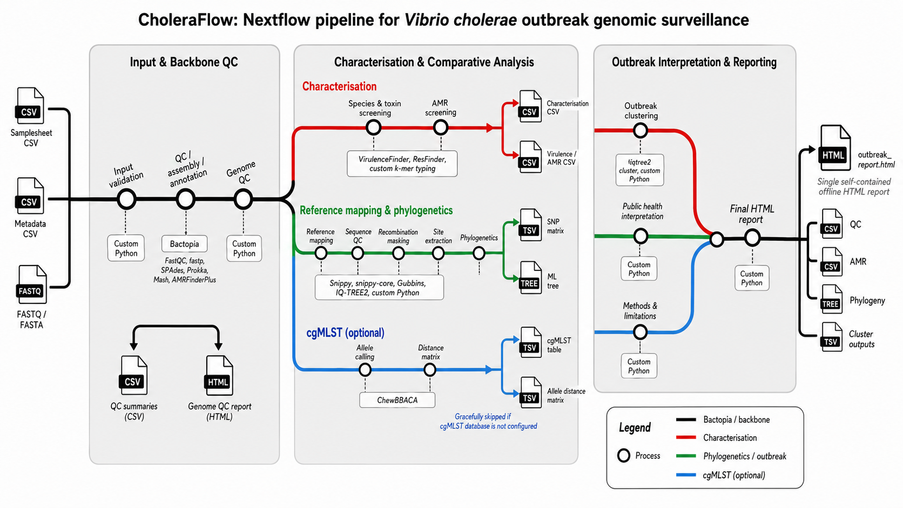

# CholeraFlow

CholeraFlow is a Nextflow DSL2 pipeline for Vibrio cholerae genomic surveillance. It provides a Bactopia-backed backbone for genome assembly and QC, followed by downstream characterisation, AMR screening, mapping, phylogenetic comparison, optional cgMLST analysis, outbreak clustering, and a self-contained HTML report for public-health review.

The pipeline is designed for reproducible, auditable outbreak investigations. Its output emphasizes clearly separated analyses, explicit `not_run` states, and transparent limitations so that genomic results are not over-interpreted without epidemiological context.

Runtime baseline: Java 21 LTS · Nextflow 24.10.5 · Python 3.11 · Jinja2 3.1.6.



## Pipeline overview

The design is deliberately arranged in three stages:

1. Input and backbone QC
   - sample-sheet validation
   - metadata validation
   - Bactopia assembly and annotation backbone
   - genome QC and per-sample assessment

2. Characterisation and comparative analysis
   - species and serogroup screening
   - virulence profiling
   - AMR screening
   - reference mapping and phylogenetic reconstruction
   - optional cgMLST allele calling and distance comparisons

3. Outbreak interpretation and reporting
   - SNP clustering and connected-component summaries
   - outbreak and related-cluster interpretation
   - final offline HTML report with limitations and next steps

The browser UI in `reference_gui.html` is a prototype; the supported operational path is the command line.

## Scientific constraints

CholeraFlow is intended for public-health surveillance, not for autonomous epidemic inference. The following rules are built into the project’s intended behaviour:

- N16961 remains the configured mapping reference unless a reviewed task explicitly changes it.
- EnteroBase Vibrio cgMLST v1 is the configured scheme: `VIBwgMLST.cgMLSTv1`, 1,128 core loci.
- Outbreak interpretation uses screening thresholds only:
  - outbreak: SNP ≤ 5, cgMLST ≤ 10
  - related cluster: SNP > 5 and ≤ 50, cgMLST > 10 and ≤ 50
  - beyond cluster: SNP > 50, cgMLST > 50
- A missing analysis is reported as `not_run`, not as a negative biological result.
- AMR genotypes do not replace patient- or isolate-level susceptibility testing.
- Genomic clustering does not prove transmission; epidemiological investigation is still required.

## Quick start

Install the required toolchain:

```bash
git clone https://github.com/pha4ge/CholeraFlow.git
cd CholeraFlow
python3 -m venv .venv
source .venv/bin/activate
python3 -m pip install -r requirements-dev.txt
```

Prepare a samplesheet and optional metadata table. Relative paths resolve relative to the samplesheet location.

```csv
sample,fastq_1,fastq_2,fasta
ISOLATE_001,reads/001_R1.fastq.gz,reads/001_R2.fastq.gz,
ISOLATE_002,reads/002.fastq.gz,,
ISOLATE_003,,,assemblies/003.fna.gz
```

Run the pipeline:

```bash
NXF_VER=24.10.5 nextflow run main.nf -profile docker \
  --input /data/samplesheet.csv \
  --metadata /data/metadata.csv \
  --outdir results \
  --bactopia_bin /path/to/bactopia \
  --ref_genbank /references/verified_N16961.gbk \
  --resfinder_db assets/databases/resfinder_db \
  --virulencefinder_db assets/databases/virulencefinder_db \
  --cgmlst_schema assets/databases/cgmlst_vibrio/schema
```

Useful notes:

- `NXF_VER=24.10.5 nextflow run main.nf --help` prints the current overview and CLI options.
- If Bactopia is already on your `PATH`, omit `--bactopia_bin`.
- Add `-resume` after a successful run to reuse cached tasks.
- A reference-based phylogeny requires at least four read samples passing sequence QC.
- Assembly-only input can be characterised and may enter cgMLST, but it does not constitute a full read-mapping phylogeny.

## Input validation and metadata rules

- One input type per row: paired-end reads, single-end reads, or assembly.
- Assembly inputs must be gzip-compressed.
- Sample IDs must be unique, contain only letters, digits and underscores, and stay within 1–50 characters.
- `Reference` and `not_run` are reserved identifiers.
- Local inputs must be non-empty regular files.
- HTTP(S)/FTP URLs are passed through to Bactopia and are not downloaded or validated by the local preprocessing layer.

Metadata is optional. When provided, it should include the epidemiological fields needed for surveillance interpretation, including sample identifiers and attributes such as `collection_date`, `country`, `admin1`, `specimen_type`, `sequencing_platform`, and `submitting_institution`. Duplicate IDs and invalid coordinates fail validation; missing matches raise warnings rather than silently constructing values.

## Database setup

The helper script manages database preparation and provenance:

```bash
python3 scripts/setup_databases.py --all
python3 scripts/setup_databases.py --prepare-cgmlst --cpu 4
```

This project tracks database revisions and checksums in a local manifest for traceability. Exact `ResFinder` and `VirulenceFinder` revisions should be pinned for a reproducible analysis. Do not commit downloaded database trees. Curated typing-marker references should be reviewed independently before use.

## Outputs and provenance

After a successful outbreak run, open the generated HTML report at `results/reports/outbreak_report.html`.

The output layout is structured like this:

```text
results/
├── pipeline_info/
├── qc/
├── characterisation/
├── mapping/
├── phylogenetics/
├── cgmlst/
├── global_context/
├── outbreak/
└── reports/
```

These directories appear only when the relevant analysis ran. `not_run` placeholders should be treated as a recorded absence of data, not as a biological negative result. Retain the original data, the `work/` directory, the database manifest, and the pipeline provenance for audit and reproducibility.

## Report structure

The HTML report is intentionally self-contained and contains no external CSS, JavaScript, or font dependencies. It always renders the following sections in order:

1. Run summary
2. QC summary
3. Cholera characterisation
4. Virulence summary
5. AMR summary
6. Phylogenetic summary
7. Global context
8. Outbreak interpretation
9. Limitations
10. Next steps
11. Methods

This structure is important for public-health review and ensures that skipped analyses are explicitly flagged instead of silently omitted.

## Validation and development

```bash
python3 -m venv .venv
source .venv/bin/activate
python3 -m pip install -r requirements-dev.txt
bash scripts/validate.sh
```

This validation path covers Python regressions and the supported Nextflow baseline. For full scientific validation, run the workflow against local data only after the relevant reference and database assets are correctly configured.

## Automated maintenance agent

The repository includes a scheduled OpenAI Codex maintenance workflow that runs every two hours on the default branch and proposes a small, validated maintenance update when the repo has a valid `OPENAI_API_KEY` secret.

The automation:

- checks for the required repository secret
- avoids stacking maintenance PRs while another review is still open
- validates the patch in a separate job before publication
- publishes a draft PR for human review only
- never merges its own work

See:

- [`.github/workflows/codex-maintenance.yml`](.github/workflows/codex-maintenance.yml)
- [`.github/codex/maintenance.md`](.github/codex/maintenance.md)

## Related documentation

- [docs/usage.md](docs/usage.md)
- [CHANGELOG.md](CHANGELOG.md)
- [VALIDATION_REPORT.md](VALIDATION_REPORT.md)
- [UPGRADE_REPORT.md](UPGRADE_REPORT.md)
