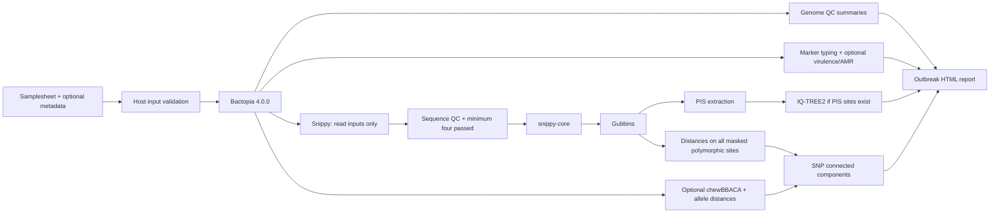

# CholeraFlow implementation contract

This document describes current code, replacing the earlier aspirational build
specification. Historical plans are not evidence that a feature is implemented.
The runtime and scientific invariants in [AGENTS.md](../AGENTS.md) apply.

## Workflow

The outbreak branch is called only for `--use_case outbreak`. Other accepted
modes currently run the core branch only. Global context is experimental and
requires independently validated column homology before use.

## Stage contracts

1. **INPUT_VALIDATE** executes on the submission host with host Python, preserving
   access to paths embedded in the CSV. It writes validated input and a Bactopia
   v4 nine-column FOFN. See [usage](usage.md) for exact field validation.
2. **RUN_BACTOPIA** invokes the configured executable with the samplesheet,
   Shovill/SPAdes selection and existing trimming/resource settings. It runs
   natively and selects its own nested Nextflow runtime unless explicitly pinned.
   Every requested sample must have nonempty assembler `.fna.gz` and statistics
   `.tsv` outputs. The inventory is retained within `bactopia_results/`.
3. **GENOME_QC** evaluates existing genome size, GC and largest-contig thresholds.
   QUAST/BUSCO/CheckM inputs are currently empty unless the workflow is extended.
   Genome-QC pass/exclusion lists are advisory, not a separate mapping gate.
4. **CHOLERA_TYPING** screens curated local marker references. VirulenceFinder
   and ResFinder use their optional databases. Missing references/DBs produce
   explicit unavailable results. These calls are not laboratory confirmation.
5. **AMR_MERGE** preserves samples with missing AMRFinderPlus outputs and can use
   ResFinder independently. No usable source yields `not_run`, not a negative
   resistance profile. Turning off local AMR does not alter Bactopia internals.
6. **SNIPPY** receives Bactopia trimmed paired/single short reads. Assembly-only
   inputs are not mapped. The reference is `params.ref_genbank`; `ref_fasta` is
   retained for compatibility/provenance and is not the Snippy input.
7. **SEQ_CLEANER** measures missing sequence. Its aggregate requires at least four
   passing read samples and completes before snippy-core. Only sequence-QC-passing
   Snippy directories enter the core alignment.
8. **SNIPPY_CORE / GUBBINS** generate the full alignment and mask recombination.
   Ordinary snippy-core failures propagate; only its no-SNP exit with a produced
   full alignment is tolerated. Gubbins failure remains a failed analysis.
9. **VARCODONS** preserves the existing PIS + minimum-coverage method for trees.
   No retained PIS sites produces empty PIS outputs; IQ-TREE2 is skipped. The
   standalone Python CLI still fails on empty PIS unless `--allow-empty` is given.
10. **IQTREE2** uses TEST+ASC, 1,000 ultrafast bootstrap replicates, a fixed seed of
    1 and automatic threads capped at `task.cpus`. The PIS-only method is retained;
    broader methodological validation remains required.
11. **SNP_DISTS** receives **all Gubbins masked polymorphic sites**, not PIS-only
    sites. This fixes loss of singleton differences and can change classifications
    relative to old runs even though distance thresholds remain unchanged.
12. **CHEWBBACA / CGMLST_DISTANCES** use assembled contigs and a prepared external
    schema containing `.schema_config`. The scheme is EnteroBase Vibrio
    `VIBwgMLST.cgMLSTv1`, 1,128 loci. Missing schema emits `not_run`. Distances count
    differences only at loci called in both samples; no shared callable loci is NA.
13. **OUTBREAK_CLUSTER** validates square, symmetric, nonnegative integer-distance
    matrices with matching unique row/column labels and zero/NA diagonals. It
    removes terminal SNP `_snippy` labels for joining, excludes `Reference`, and
    assigns connected components at the SNP outbreak threshold. cgMLST is an
    optional concordance check; it does not define the SNP components.
14. **GENERATE_REPORT** renders Jinja2 sections from supplied outputs. Skipped
    inputs remain explicitly unavailable. It reports genome-QC status without
    asserting phylogenetic inclusion and describes connected-component links
    without claiming every within-component pair is below threshold.

## Preserved scientific defaults

| Parameter | Default |
| --- | --- |
| min_trim_quality / min_trim_length | 20 / 50 |
| min_mapping_quality / min_base_quality | 20 / 20 |
| min_site_coverage / min_allele_fraction | 5 / 0.75 |
| max_missing_percentage | 50 |
| min_parsimony_coverage | 0.70 |
| snp_outbreak_threshold / snp_cluster_threshold | 5 / 50 |
| cgmlst_outbreak_alleles / cgmlst_cluster_alleles | 10 / 50 |
| gubbins_tree_builder | raxml |

Outbreak thresholds must not exceed cluster thresholds. Percentage/fraction,
integer, mode and boolean parameters are checked before processes launch.
Unimplemented long/hybrid, plasmid, FastBAPS and rapid-report requests fail
explicitly rather than giving a false impression they ran.

N16961 remains the intended mapping reference. The legacy default GenBank
filename alone does not verify that identity; supply a validated N16961 file and
retain its accession/checksum. Neither this maintenance nor scheduled agents
replace reference sequences or database snapshots automatically.

## Reproducibility and validation boundaries

Nextflow writes trace/timeline/execution report/DAG and completion provenance.
The JSON contains effective parameters, command, runtime, success and SHA-256
fingerprints; a provided database manifest is copied into run records. Bactopia's
nested runtime and database versions must also be retained from its own records.
Container tags and package pins are declared by modules; tags are not immutable
image digests. A fully frozen deployment must retain image digests/environments.

[Validation](../VALIDATION_REPORT.md) distinguishes Python regressions and
synthetic workflow tests from third-party container and real-cohort validation.
No synthetic smoke output is a genomic or epidemiological result.

## Known gaps requiring reviewed follow-up

- Genome-QC exclusion is not currently wired as a second mapping/cgMLST gate.
- Read-trimming/QC outputs absent from Bactopia can omit samples from mapping;
  per-sample mapping eligibility and exclusion accounting need expansion.
- Long/hybrid mapping, assembly mapping and mode-specific cohort reports.
- Real-cohort validation of the retained PIS tree model, invariant/low-diversity
  Gubbins behavior, masks, bootstrap interpretation and ascertainment handling.
- Codon annotations, genomic coordinate reconstruction and global homology checks.
- Fully pinned nested Bactopia assets, software versions and container digests.
- Curated and independently characterised marker controls; GUI/backend integration.

These gaps must not be hidden by reports or counted as validated features.
